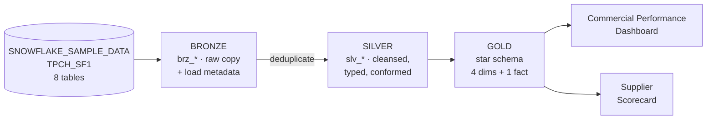

# TPC-H Commercial Performance: Medallion Architecture on Snowflake + dbt

An end-to-end Medallion (**Bronze → Silver → Gold**) data product built with **dbt Core** on **Snowflake**, using `SNOWFLAKE_SAMPLE_DATA.TPCH_SF1`. TPC-H models a wholesale supplier: customers place orders, each order has line items, and each line item is a part bought from a supplier.

The Gold layer is a **contract-enforced star schema for commercial performance**: revenue, discount and gross margin by customer, geography, product and time, plus supplier delivery performance.

**Live lineage (dbt docs):** https://william-nascimento-garcia.github.io/propelling-datachallenge/



---

## Contents

1. [Analytical use case](#1-analytical-use-case)
2. [Layers and design principles](#2-layers-and-design-principles)
3. [Data quality](#3-data-quality)
4. [Observability](#4-observability-run-log-in-snowflake)
5. [CI/CD](#5-cicd-github-actions)
6. [Python analysis](#6-python-analysis)
7. [Setup](#7-setup-windows--vs-code)
8. [Project structure](#8-project-structure)
9. [Production roadmap](#9-what-i-would-add-in-production)

---

## 1. Analytical use case

| | |
|---|---|
| **Business question** | Where do we make money, where do we lose it, and which suppliers put revenue at risk? |
| **Consumers** | Commercial Director and Sales / Category Managers · Supply Chain / Procurement Manager |
| **Decisions supported** | Discount policy per segment, regional and product focus, supplier renegotiation or replacement |

Questions the Gold layer answers directly:

1. How do net revenue and gross margin evolve per region and year?
2. In which market segments does discounting erode margin the most?
3. Which brands and materials generate the most margin?
4. Which suppliers deliver late most often, and how much revenue is exposed?
5. Who are the top customers by revenue, and how profitable are they?

Gross margin is possible because `PARTSUPP` holds the **supply cost of each part from each supplier**. The fact joins on `(part, supplier)`, so every line has an exact cost.

---

## 2. Layers and design principles

| Layer | Schema | What happens | What is **not** allowed |
|---|---|---|---|
| **Bronze** | `BRONZE` | Copy of the 8 source tables with original names and types, plus `_loaded_at`, `_batch_id` and `_source_relation`. By default every row lands **twice**, to simulate a source re-sending data | Renaming, filtering, business logic |
| **Silver** | `SILVER` | Deduplication, keys as strings, numbers as `NUMBER(p,s)`, business names, decoded codes, split composite attributes, conformed geography, reusable revenue rules and delivery KPIs. Contracts enforced | Use-case-specific modelling or aggregation |
| **Gold** | `GOLD` | Star schema: 4 dimensions and 1 fact at order-line grain. Contracts enforced; `REPORTER` gets read grants | Further cleansing (it belongs in Silver) |

### Bronze: why not query the source directly?

- **Decoupling:** the sample data is a read-only share we do not control. Bronze is the only layer that knows the source.
- **Reprocessing:** if a Silver rule is wrong, Silver and Gold are rebuilt from Bronze without touching the source again.
- **Auditability:** `_loaded_at` and `_batch_id` record when and from which run every row arrived.
- **Duplicates are allowed here:** Bronze is a faithful landing zone. To prove the pipeline copes with a source that re-sends data, `simulate_duplicates: true` (in `dbt_project.yml`) lands every row twice, with a later `_loaded_at` on the copy. Set it to `false` for a clean 1:1 copy.

### Silver: what problems does it solve?

TPC-H is synthetic and clean, so the problems are **semantic and structural, not dirty data**:

| Raw problem | Silver fix |
|---|---|
| Duplicated deliveries in Bronze | `deduplicate` macro keeps the latest version per business key (`QUALIFY ROW_NUMBER()`) |
| Cryptic prefixed names (`L_EXTENDEDPRICE`, `O_CUSTKEY`) | Business names (`extended_price`, `customer_id`) |
| Keys stored as numbers, measures without fixed precision | Keys cast to `varchar`, measures to explicit `NUMBER(p,s)`, enforced by contracts |
| Coded values (`O_ORDERSTATUS` F/O/P, `L_RETURNFLAG` R/A/N) | Decoded labels |
| Several attributes in one string (`'1-URGENT'`, `'STANDARD POLISHED TIN'`, `'SM CASE'`) | Split into atomic columns |
| Upper-case labels (`UNITED STATES`) | Readable labels (`United States`) |
| Business measures that don't exist yet | `net_amount`, `discount_amount`, `gross_amount_with_tax`, `is_late_delivery`, `delivery_delay_days` |
| Normalised geography (nation → region) | `slv_geography`, conformed once and reused by customer and supplier |

**Why here and not in Gold?** These rules are true for the whole business, whatever the use case. Any future mart reuses `net_amount` and the decoded statuses instead of redefining them, so there is **one definition of revenue** (it lives in `macros/business_rules.sql`).

### Gold: star schema


- **Grain:** one row per order line (≈ 6M rows).
- **Surrogate keys:** deterministic hashes (`dbt_utils.generate_surrogate_key`). They decouple the model from source keys, turn composite keys into one column, and are identical after every rebuild.
- **LEFT JOINs:** a line is never silently dropped because a lookup is missing. An orphan becomes a NULL key and fails the `not_null` tests.
- **Degenerate dimensions:** order id, status and priority stay on the fact.
- **Role-playing `dim_date`:** used for order, ship, commit and receipt dates.
- **Denormalised dimensions:** nation and region are flattened into customer and supplier, so BI needs one join.
- **PII minimisation:** addresses and phone numbers are not exposed in Gold.
- **Model contracts:** column names and types are a promise to consumers; the build fails if a change breaks them.

---

## 3. Data quality

Severity depends on the layer:

| Layer | Key tests | Severity | Why |
|---|---|---|---|
| Source / Bronze | `not_null` on keys, `equal_rowcount` vs source (no `unique`) | **warn** | Bronze is a faithful copy: duplicates may land and are removed by Silver. Source issues are reported, never block |
| Silver / Gold | `not_null` on every key, `unique` on every primary key (`unique_combination_of_columns` for composite keys) | **error** | After deduplication, a duplicate or null key can only be a bug. The build stops before bad data reaches consumers |

**Custom generic tests** (`macros/tests/`):

| Test | Example |
|---|---|
| `is_positive` | Quantities, prices and revenue must be > 0 (or ≥ 0) |
| `not_before` | A receipt cannot happen before the shipment, nor a shipment before the order |
| `sum_matches` | **Cross-layer reconciliation:** total revenue in Gold equals Silver, proving joins neither lost nor duplicated rows |

Plus one singular test (`tests/assert_margin_not_above_net_revenue.sql`): margin can never exceed revenue.

**Reusable macros** (`macros/`):

| Macro | Purpose |
|---|---|
| `generate_schema_name` | Exact `BRONZE/SILVER/GOLD` in prod; isolated `DEV_<NAME>_*` and `CI_PR_<n>_*` sandboxes elsewhere |
| `bronze_ingest` | One landing pattern for all 8 Bronze models (and the duplicate simulation) |
| `deduplicate` | One row per business key in Silver (latest `_loaded_at` wins) |
| `net_amount`, `gross_amount_with_tax`, `clean_label` | Single definition of business rules |
| `log_run_results` | `on-run-end` hook that writes every run to `AUDIT.DBT_RUN_RESULTS` |
| `drop_schemas_with_prefix` | Cleans up the CI schemas, with safety guards |

---

## 4. Observability: run log in Snowflake

An `on-run-end` hook writes one row per executed model, test, seed or snapshot to **`TPCH_ANALYTICS.AUDIT.DBT_RUN_RESULTS`** at the end of every `dbt build`, `run` or `test`, in every environment (dev, CI, prod):

| Column | Meaning |
|---|---|
| `invocation_id`, `command`, `target_name`, `run_started_at` | Which run, which command, which environment |
| `node_name`, `resource_type`, `schema_name` | What was executed |
| `status`, `failures`, `message` | Result: `success`, `pass`, `warn`, `fail`, `error`, `skipped` |
| `execution_time_s`, `rows_affected`, `query_id` | Performance, with a link to Snowflake's query history |

It stores structured results (the same content as `target/run_results.json`), not log text, in its own `AUDIT` schema outside the medallion layers. Ready-made queries: `_snowflake_setup/03_run_log_queries.sql`.

---

## 5. CI/CD (GitHub Actions)

| Workflow | Trigger | Steps |
|---|---|---|
| `ci.yml` | Pull request to `main` | sqlfluff lint → **Slim CI**: `dbt build --select state:modified+ --defer` in schema `CI_PR_<n>_*` (unchanged models are read from prod) → drop the PR schemas |
| `cd.yml` | Merge to `main`, manual run, daily schedule | `dbt build --target prod` → `dbt docs generate` → publish to **GitHub Pages** → store `manifest.json` for the next Slim CI |

Value: nothing reaches production untested, PRs only rebuild what changed, every change is reviewable and reversible, and the documentation and lineage are always current.

Repository secrets used by both workflows: `SNOWFLAKE_ACCOUNT`, `SNOWFLAKE_USER`, `SNOWFLAKE_PRIVATE_KEY`.

---

## 6. Python analysis

Exploratory analysis and charts with **pandas**, querying Snowflake through a small client in `_modules/`.

```python
import sys
sys.path.append(r'<project>\_modules')
from snowflake_client import SnowflakeClient

sf = SnowflakeClient(target="dev", layer="gold")   # layer: bronze | silver | gold | audit
sf.connect()
df = sf.to_pandas(sf.query("select * from fct_order_lines limit 1000"))
sf.close()
```

| Component | Purpose |
|---|---|
| `_modules/snowflake_client.py` | `SnowflakeClient`: connects with key-pair auth, picks the layer and environment (`dev` / `prod`), runs queries and converts results to pandas |
| `_modules/cripto.py` | `Encryptor`: encrypts and decrypts the credentials file (AES-GCM via `cryptocode`) |
| `_credentials/` | Encrypted credentials (`snowflake.json`) and key (`snowflake.key`), both **git-ignored**. Create them with `_credentials/generate_credentials.py` |
| `analysis/` | Analysis scripts: data profiling per layer (`bronze/`), dbt run history (`audit/`) and charts |

---

## 7. Setup (Windows + VS Code)

### Prerequisites

- [Python 3.12](https://www.python.org/downloads/) (dbt is not yet reliable on 3.13)
- [Git for Windows](https://git-scm.com/download/win) (also provides `openssl`)
- VS Code (recommended extensions in `.vscode/extensions.json`)
- A [Snowflake trial account](https://signup.snowflake.com/) (Enterprise, AWS, a European region)

### Step 1: Python environment

The virtual environment lives **outside OneDrive**, so OneDrive does not sync thousands of package files.

```powershell
python -m venv "$env:USERPROFILE\.venvs\propelling"
& "$env:USERPROFILE\.venvs\propelling\Scripts\Activate.ps1"
pip install -r requirements.txt
```

### Step 2: Key pair for the dbt service user

```powershell
.\_local_setup\generate_keypair.ps1   # keys go to %USERPROFILE%\.snowflake; public key copied to clipboard
```

### Step 3: Snowflake objects

Run `_snowflake_setup/01_snowflake_setup.sql` in a Snowsight worksheet (**Run All**), with your Snowsight user and the public key in place. It creates the roles `TRANSFORMER` and `REPORTER`, the warehouses, the database `TPCH_ANALYTICS` with schemas `BRONZE/SILVER/GOLD`, the service user `DBT_USER` and a resource monitor.

### Step 4: Connection variables

```powershell
Copy-Item _local_setup\set_env.example.ps1 _local_setup\set_env.ps1   # git-ignored
notepad _local_setup\set_env.ps1                                      # fill in SNOWFLAKE_ACCOUNT
. .\_local_setup\set_env.ps1                                          # in every new terminal
dbt debug                                                             # "All checks passed!"
```

For VS Code (dbt Power User extension, integrated terminals), the same variables can go in a git-ignored `.env` file at the project root.

### Step 5: Run

```powershell
dbt deps
dbt build                       # dev:  DEV_<NAME>_BRONZE / _SILVER / _GOLD
dbt build --target prod         # prod: BRONZE / SILVER / GOLD
dbt docs generate; dbt docs serve
```

Expect `WARN=1`: the Bronze row-count test reports the simulated duplicates. For a clean 1:1 Bronze: `dbt build --vars "{simulate_duplicates: false}"`.

### Step 6: GitHub

1. **Settings → Secrets and variables → Actions:** add `SNOWFLAKE_ACCOUNT`, `SNOWFLAKE_USER` and `SNOWFLAKE_PRIVATE_KEY` (the full content of the `.p8`).
2. **Settings → Pages → Source:** *GitHub Actions*.
3. **Actions → dbt CD → Run workflow** once, to build prod, publish the docs and store the first manifest.

---

## 8. Project structure

```
├── models/
│   ├── bronze/          _tpch__sources.yml, _bronze__models.yml, brz_*.sql (8)
│   ├── silver/          _silver__models.yml, slv_*.sql (7)
│   ├── gold/            _gold__models.yml, exposures.yml, dim_*.sql (4), fct_order_lines.sql
│   └── overview.md      dbt docs home page
├── macros/              schema naming, bronze pattern, deduplication, business rules, run log, CI cleanup
│   └── tests/           custom generic tests
├── tests/               singular tests
├── analysis/            Python analysis scripts and charts (pandas)
├── _modules/            Snowflake client + credential encryption
├── _credentials/        encrypted credentials + key (git-ignored; only README and generator versioned)
├── _snowflake_setup/    Snowflake setup + demo and run-log queries
├── _local_setup/        Windows helpers: key pair, environment variables
├── docs/                DESIGN_DECISIONS.md (design questions of the challenge)
├── .github/workflows/   ci.yml, cd.yml
├── dbt_project.yml · profiles.yml · packages.yml · requirements.txt
```

---

## 9. What I would add in production

See [`docs/DESIGN_DECISIONS.md`](docs/DESIGN_DECISIONS.md) for the full reasoning.

- **Ingestion:** incremental, append-only Bronze (Snowpipe / Openflow / Fivetran) with history, plus `dbt source freshness`.
- **History:** dbt snapshots (SCD Type 2) for customer and supplier attributes.
- **Performance:** `fct_order_lines` as incremental `merge` once volumes grow beyond SF1.
- **Orchestration:** Airflow / Dagster / dbt Cloud jobs with SLAs and retries, instead of a cron in GitHub Actions.
- **Observability:** the run log exists; next come Slack alerts on `fail` / `warn`, Elementary for volume and freshness anomalies, and cost dashboards from `ACCOUNT_USAGE`.
- **Testing:** value-domain tests (accepted values, ranges), referential integrity (`relationships`) and dbt unit tests for complex logic.
- **Security:** masking policies on PII, row access policies, separate dev and prod databases, a secrets manager instead of local key files.
- **Semantic layer:** metrics such as net revenue and gross margin defined once, so every BI tool shows the same number.
