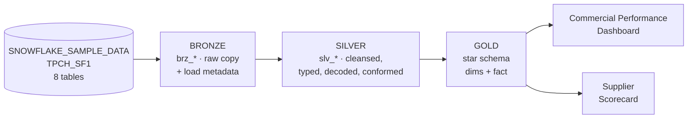
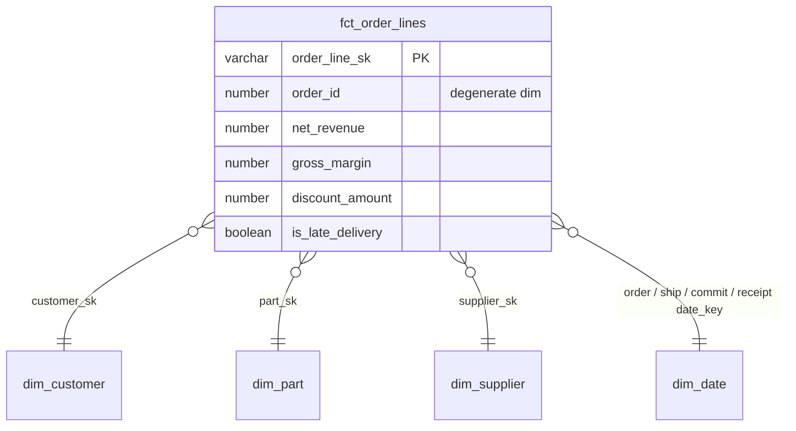

# TPC-H Commercial Performance: a Medallion Architecture on Snowflake + dbt

This is an end-to-end Medallion (Bronze → Silver → Gold) data product. It is built with **dbt Core** on **Snowflake** and uses `SNOWFLAKE_SAMPLE_DATA.TPCH_SF1` as its source. TPC-H models a wholesale supplier: customers place orders, each order has line items, and each line item is a part bought from a supplier.

The Gold layer is a **contract-enforced star schema for commercial performance**: revenue, discount and gross margin by customer, geography, product and time. It also includes a **supplier scorecard** covering late deliveries, returns and revenue at risk.



---

## 1. Analytical use case

| | |
|---|---|
| **Business question** | Where do we make money, where do we lose it, and which suppliers put revenue at risk? |
| **Primary consumers** | Commercial Director, Sales & Category Managers · Supply Chain / Procurement Manager. Both query `fct_order_lines` and its dimensions |
| **Decisions supported** | Discount policy per segment, regional and product focus, supplier renegotiation and replacement |

Example questions the Gold layer answers directly (see `analyses/` and `setup/02_demo_queries.sql`):

1. How do net revenue and gross margin evolve per region and year?
2. In which market segments does discounting erode margin the most?
3. Which brands and materials generate the most margin?
4. Which suppliers deliver late most often, and how much revenue is exposed?
5. Who are the top customers by revenue, and how profitable are they?

Gross margin is possible because `PARTSUPP` holds the **supply cost of each part from each supplier**. The fact joins on `(part, supplier)`, so every line has an exact cost.

---

## 2. Layers and design principles

| Layer | Schema | What happens | What is **not** allowed |
|---|---|---|---|
| **Bronze** | `BRONZE` | Copy of the 8 source tables with original names and types, plus `_loaded_at`, `_batch_id` and `_source_relation`. By default every row lands **twice** to simulate a source re-sending data (`simulate_duplicates` var), so the Silver deduplication is exercised on every run | Renaming, filtering, business logic |
| **Silver** | `SILVER` | Deduplication (one row per business key), keys as strings, numbers as `NUMBER(p,s)`, business names, decoded codes, composite attributes split, conformed geography, reusable revenue rules and delivery KPIs. Contracts are enforced | Use-case-specific aggregation or modelling |
| **Gold** | `GOLD` | Star schema: 4 dimensions and 1 fact at order-line grain. Contracts are enforced and `REPORTER` gets read grants | Further cleansing (it belongs in Silver) |

### Bronze: why not query the source directly?

- **Decoupling:** the sample data is a read-only share that we do not control. Bronze is the only layer that knows the source.
- **Reprocessing:** if a Silver rule is wrong, Silver and Gold are rebuilt from Bronze without touching the source again. In a real system the source is an ERP or API that may be slow, rate-limited or change.
- **Auditability:** `_loaded_at` and `_batch_id` record when and from which run every row arrived, and Time Travel works on our own tables.
- **Completeness checks:** row-count and key tests prove the copy is complete before anything else runs.

### Silver: what problems does it solve?

TPC-H is synthetic and has no nulls, so the problems are **semantic and structural, not dirty data**:

| Raw problem | Silver fix |
|---|---|
| Cryptic prefixed names (`L_EXTENDEDPRICE`, `O_CUSTKEY`) | Business names (`extended_price`, `customer_id`) |
| Coded values (`O_ORDERSTATUS` F/O/P, `L_RETURNFLAG` R/A/N, `L_LINESTATUS`) | Decoded labels |
| Several attributes packed into one string (`'1-URGENT'`, `'STANDARD POLISHED TIN'`, `'SM CASE'`, `'Clerk#000000951'`) | Split into atomic, filterable columns |
| Upper-case labels (`UNITED STATES`) | Readable labels (`United States`) |
| Business measures that don't exist yet | `net_amount`, `discount_amount`, `gross_amount_with_tax`, `is_late_delivery`, `delivery_delay_days`, `transit_days` |
| Normalised geography (nation → region) | `slv_geography`, conformed once and reused by customer and supplier |
| No surrogate keys for composite grains | `order_line_id`, `part_supplier_id` |
| Possible duplicate deliveries (re-sent files, overlapping loads) | `deduplicate` macro keeps the latest version per business key, proven by `unique` tests. TPC-H has none today, and `analyses/06_duplicates_removed_in_silver.sql` shows 0 removed |
| Keys stored as numbers, measures without fixed precision | Every key cast to `varchar`, every quantity, price or rate to an explicit `NUMBER(p,s)`, all enforced by contracts |

**Why here and not in Gold?** These rules are true for the whole business, whatever the use case. A future logistics or finance mart reuses `net_amount` and the decoded statuses instead of redefining them, so there is **one definition of revenue**. The rule itself lives in a macro (`macros/business_rules.sql`).

### Gold: star schema



- **Grain of `fct_order_lines`:** one row per order line (≈ 6M rows).
- **Degenerate dimensions:** order id, status and priority stay on the fact. A separate order dimension would be 1:1 with the order header and add a join for nothing.
- **Role-playing `dim_date`:** used for order, ship, commit and receipt dates.
- **Denormalised dimensions:** nation and region are flattened into the customer and supplier dimensions, so a BI tool needs a single join.
- **PII minimisation:** the street address is not exposed in Gold.
- **No pre-aggregated tables:** the fact is at the lowest grain, so any aggregation (month × region, supplier × year...) is one `GROUP BY` away. In production, shared metrics would live in a semantic layer rather than in extra physical tables.
- **Clustering:** the fact is clustered by `order_date_key`.
- **Model contracts:** column names and types are a promise to consumers. The build fails if a change breaks them.

---

## 3. Quality and reusability

**Macros** (`macros/`)

| Macro | Purpose |
|---|---|
| `deduplicate` | One row per business key in Silver (latest `_loaded_at` wins) |
| `generate_schema_name` | Exact `BRONZE/SILVER/GOLD` names in prod, isolated `DEV_<NAME>_*` / `CI_PR_<n>_*` sandboxes elsewhere |
| `bronze_ingest` | One landing pattern for all 8 Bronze models |
| `net_amount`, `gross_amount_with_tax`, `clean_label` | Single definition of business rules |
| `log_run_results` | `on-run-end` hook: writes every run's results to `AUDIT.DBT_RUN_RESULTS` |
| `drop_schemas_with_prefix` | CI housekeeping, with safety guards |

**Custom generic tests** (`macros/tests/`)

| Test | Example |
|---|---|
| `is_positive` | Quantities, prices and revenue must be > 0 (or ≥ 0) |
| `not_before` | `receipt_date` cannot be before `ship_date`, and shipping cannot be before ordering |
| `sum_matches` | **Cross-layer reconciliation:** total revenue in Gold = Silver, proving joins neither lost nor duplicated rows |

On top of that, the key rules, with a severity that depends on the layer:

| Layer | Key tests | Severity | Why |
|---|---|---|---|
| Source / Bronze | `not_null` on keys, `equal_rowcount` (no `unique`) | **warn** | Bronze is a faithful copy: duplicates may land and are removed by Silver, so source issues are reported but never block the pipeline |
| Silver / Gold | `not_null` on every key, `unique` on every primary key (`unique_combination_of_columns` for composite keys) | **error** | After deduplication, a duplicate or null key can only be a bug, so the build stops before bad data reaches consumers |

One singular test (margin can never exceed revenue) completes the set.

---

## 4. Observability: run log in Snowflake

An `on-run-end` hook (`macros/log_run_results.sql`) writes one row per executed model, test, seed or snapshot to **`TPCH_ANALYTICS.AUDIT.DBT_RUN_RESULTS`** at the end of every `dbt build`, `run` or `test`, in every environment (dev, CI, prod):

| Column | Meaning |
|---|---|
| `invocation_id`, `command`, `target_name`, `run_started_at` | Which run, which command, which environment |
| `node_name`, `resource_type`, `schema_name` | What was executed |
| `status`, `failures`, `message` | Result (`success`, `pass`, `warn`, `fail`, `error`, `skipped`) |
| `execution_time_s`, `rows_affected`, `query_id` | Performance, with a link to Snowflake's query history |

It stores structured results (the same content as `target/run_results.json`), not log text. It lives in its own `AUDIT` schema, outside the medallion layers and the lineage graph. Ready-made queries are in `setup/03_run_log_queries.sql` and `analyses/07_dbt_run_history.sql`.

## 5. CI/CD (GitHub Actions)

| Workflow | Trigger | Steps |
|---|---|---|
| `ci.yml` | Pull request to `main` | sqlfluff lint → **Slim CI**: `dbt build --select state:modified+ --defer` in schema `CI_PR_<n>_*` → drop the PR schemas |
| `cd.yml` | Merge to `main`, manual, daily schedule | `dbt build --target prod` → `dbt docs generate` → publish docs to **GitHub Pages** → save `manifest.json` for the next Slim CI |

Value: nothing reaches production untested, PRs only rebuild what changed (time and credits), every change is reviewable and reversible, and the documentation and lineage are always current.

---

## 6. Setup (Windows + VS Code)

### Prerequisites

- [Python 3.12](https://www.python.org/downloads/) (tick *Add to PATH*). dbt is not yet reliable on 3.13.
- [Git for Windows](https://git-scm.com/download/win) (also provides `openssl`)
- VS Code. The recommended extensions are listed in `.vscode/extensions.json`.
- A [Snowflake trial account](https://signup.snowflake.com/) (Enterprise, AWS, a European region)

### Step 1: Python environment

The virtual environment is kept **outside OneDrive**, so OneDrive does not sync thousands of package files.

```powershell
cd "C:\Users\William Ordiales\OneDrive\Documentos\propelling_datachellenge"
python -m venv "$env:USERPROFILE\.venvs\propelling"
& "$env:USERPROFILE\.venvs\propelling\Scripts\Activate.ps1"
# if blocked: Set-ExecutionPolicy -Scope CurrentUser RemoteSigned
pip install -r requirements.txt
```

### Step 2: Key pair for the dbt service user

```powershell
.\scripts\generate_keypair.ps1     # keys go to %USERPROFILE%\.snowflake, public key copied to clipboard
```

### Step 3: Snowflake objects

Open `setup/01_snowflake_setup.sql` in a Snowsight worksheet. Replace `<YOUR_SNOWSIGHT_USER>` and `<PASTE_PUBLIC_KEY_HERE>`, then **Run All**. This creates the roles `TRANSFORMER` and `REPORTER`, the warehouses, the database `TPCH_ANALYTICS` with schemas `BRONZE/SILVER/GOLD`, the service user `DBT_USER` and a resource monitor.

### Step 4: Connection variables

```powershell
Copy-Item scripts\set_env.example.ps1 scripts\set_env.ps1   # git-ignored
notepad scripts\set_env.ps1                                 # fill in SNOWFLAKE_ACCOUNT
. .\scripts\set_env.ps1                                     # run in every new terminal
dbt debug                                                   # "All checks passed!"
```

### Step 5: Run

```powershell
dbt deps                       # install packages
dbt build                      # dev:  DEV_WILLIAM_BRONZE / _SILVER / _GOLD
dbt build --target prod        # prod: BRONZE / SILVER / GOLD
dbt docs generate; dbt docs serve   # lineage graph at http://localhost:8080
```

**Python client (`_modules/snowflake_client.py`).** For notebooks and scripts, the Snowflake credentials (account, user and private key) are stored **encrypted** in the git-ignored `_credentials/` folder (`snowflake.json` + `snowflake.key`), and are encrypted and decrypted by `_modules/cripto.py` (AES-GCM via `cryptocode`). Create them once with `python scripts\encrypt_credentials.py`; after that no credentials need to be passed:

```python
from snowflake_client import SnowflakeClient
sf = SnowflakeClient(target="dev", layer="bronze").connect()
```

Useful selections: `dbt build -s tag:silver`, `dbt build -s +fct_order_lines`, `dbt test -s gold`.

Bronze duplicates every source row by default (expect `WARN=1` from `equal_rowcount` on `brz_lineitem`). For a clean 1:1 Bronze: `dbt build --vars "{simulate_duplicates: false}"`.

### Step 6: GitHub and CI/CD

1. Create a **public** repository and push this folder. (GitHub Pages on a private repo needs a paid plan.)
2. **Settings → Secrets and variables → Actions:** add `SNOWFLAKE_ACCOUNT`, `SNOWFLAKE_USER` (`DBT_USER`) and `SNOWFLAKE_PRIVATE_KEY` (the full content of `dbt_rsa_key.p8`, including the BEGIN/END lines).
3. **Settings → Pages → Source:** select *GitHub Actions*.
4. Run the **dbt CD** workflow once (Actions → dbt CD → *Run workflow*). It builds prod, publishes the docs and stores the first production manifest.
5. From then on, every PR runs **dbt CI**.

---

## 7. Project structure

```
├── models/
│   ├── bronze/   _tpch__sources.yml, _bronze__models.yml, brz_*.sql (8)
│   ├── silver/   _silver__models.yml, slv_*.sql (7)
│   ├── gold/     _gold__models.yml, exposures.yml, dim_*.sql (4), fct_order_lines.sql
│   └── overview.md                 # dbt docs home page
├── macros/       schema naming, bronze pattern, deduplication, business rules, run log, CI cleanup
│   └── tests/    custom generic tests
├── tests/        singular tests
├── analyses/     business questions answered on Gold
├── setup/        Snowflake setup + demo queries
├── scripts/      Windows helpers (key pair, env vars, credential encryption)
├── _modules/     Python client for Snowflake + credential encryption (cripto.py)
├── _credentials/ encrypted credentials + key (git-ignored, only README versioned)
└── .github/workflows/   ci.yml, cd.yml
```

---

## 8. What I would add in production

See [`docs/DESIGN_DECISIONS.md`](docs/DESIGN_DECISIONS.md) for the full reasoning. In short:

- **Ingestion:** incremental, append-only Bronze (Snowpipe / Fivetran / Openflow) with full history, plus `dbt source freshness`.
- **History:** dbt snapshots (SCD Type 2) for customer and supplier attributes.
- **Incremental models:** `fct_order_lines` as incremental `merge` once volumes grow beyond SF1.
- **Orchestration:** Airflow / Dagster / dbt Cloud jobs with SLAs and retries, instead of a cron in GitHub Actions.
- **Observability:** the run log already exists (`AUDIT.DBT_RUN_RESULTS`). Next steps: Slack alerts on `fail` / `warn`, Elementary for volume, freshness and schema anomalies, and query-cost dashboards from `ACCOUNT_USAGE`.
- **Security:** masking policies on PII (names, phones), row access policies, separate dev and prod databases, SSO for humans.
- **Semantic layer:** metrics such as net revenue and gross margin defined once in the dbt Semantic Layer, so every BI tool shows the same number.
- **Governance:** data contracts with source owners, model versions for breaking changes, and `dbt_project_evaluator` for best-practice checks.
